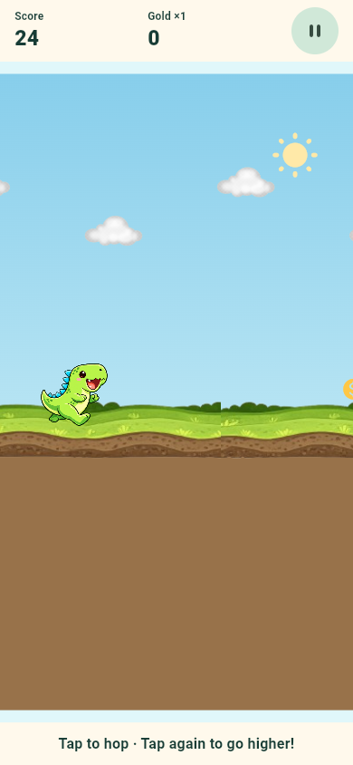
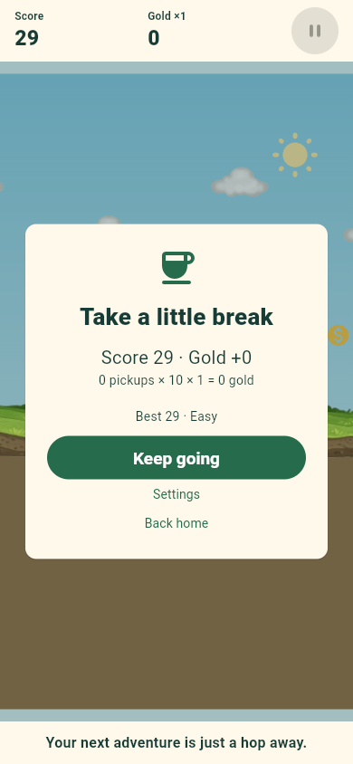

# Little Dino

A gentle Flutter dinosaur runner for children aged 6–8, published by
**BlackAlpha-debug**. Offline gameplay, no advertising, no real-money purchases, no accounts
and no analytics. This repository is being prepared for Google Play; store
publication still requires the owner's release details and device/user testing.

## Play

Tap **Play**, then tap anywhere in the play area to jump. Tap again in the air
for a double jump. Avoid cacti and flying dinosaurs, collect gold and unlock
new dinosaurs. Easy, Normal and Hard give ×1, ×2 and ×3 gold respectively and
have separate saved best scores. Pause at any time;
backgrounding the app pauses the run and requires an explicit resume.

Visit **Dino Shop** for free previews and coin purchases, **My Dinosaurs** to
choose an owned character, and **Weekly Gifts** for a repeating seven-gift cycle.
Sprout is free; Bramble costs 1,000, Sunny 10,000 and Nova 25,000 earned gold.
There are no real-money coin purchases or cash value. Missed days do not remove
gift progress. Settings include difficulty, sound effects and extra effects. **For grown-ups**
contains offline/privacy information, third-party licenses and confirmed local
progress reset. Progress and preferences stay on the device.

## Preview

| Home | Gameplay | Pause |
| --- | --- | --- |
|  |  |  |

| Dino shop | Character preview | Weekly gifts |
| --- | --- | --- |
|  |  |  |

## Development setup

Validated with Flutter 3.44.7 / Dart 3.12.2. Dependencies are locked in
`pubspec.lock`. Android SDK and Java 17 are needed for command-line Android builds.

```sh
flutter pub get
flutter run -d chrome
flutter analyze --no-pub
flutter test --no-pub
flutter build apk --debug
```

On Windows, run `powershell -File tools/verify.ps1` for the complete local check,
or add `-SkipAndroidBuild` for Dart/widget checks only. No Android Studio or
emulator is required. Connect a physical phone for Android gameplay verification.

## Architecture

- `lib/game_engine.dart`: fixed-step simulation, explicit run states, safe obstacle
  queues, capped difficulty, collision boxes, stars and distance-derived scenery.
- `lib/main.dart`: accessible menu/game/pause/results flows and lifecycle handling.
- `lib/game_scene.dart`, `lib/dino_avatar.dart`, `lib/rain.dart`: scaled logical
  playfield, transparent character and simulation-driven visual effects.
- `lib/player_progress.dart`: versioned local preferences, serialized writes,
  separate scores, stars, unlocks and recoverable storage errors.
- `lib/game_audio.dart`: short bundled effects; no remote audio.
- `test/`: regression checks for simulation, UI and persistence.
- `tools/generate_sounds.py`: reproducible original sound effects.

## Plan and release

- [Detailed implementation phases](docs/IMPLEMENTATION_PLAN.md)
- [Android signing and Play Console checklist](docs/RELEASE.md)
- [Complete privacy policy — ready to publish on Notion](docs/PRIVACY_POLICY.md)
- [Android compatibility and optimization](docs/ANDROID_COMPATIBILITY.md)
- [Coin/shop/weekly-gift implementation phases](docs/COINS_CHARACTERS_PLAN.md)
- [Future ads integration — currently disabled](docs/ADVERTISING.md)
- [Asset provenance and rights checks](docs/ASSETS.md)
- [Validation results and remaining manual checks](docs/VALIDATION.md)

Production builds deliberately require a permanent application ID, support
email, hosted privacy-policy URL and private upload-key configuration. Read the
release runbook. Never commit passwords, keystores or real signing properties.

## License

Original project code: MIT, Copyright 2022 Hevesh Lakhwani; see [LICENSE](LICENSE).
Original artwork sources are preserved; their commercial-use rights must be
verified by the publisher. See the asset provenance document. Platform/package
licenses are accessible from the in-app grown-ups area.
