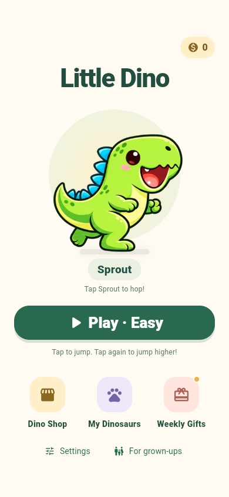
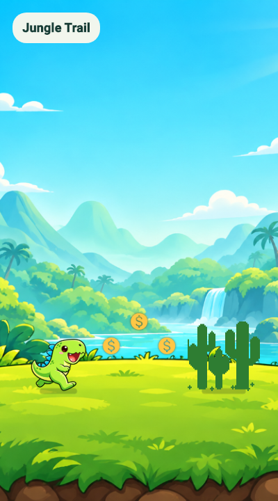
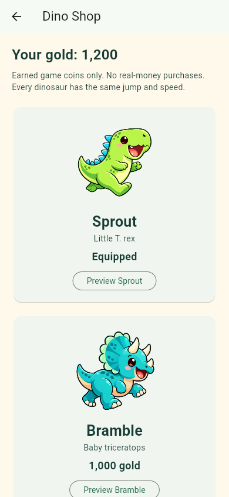
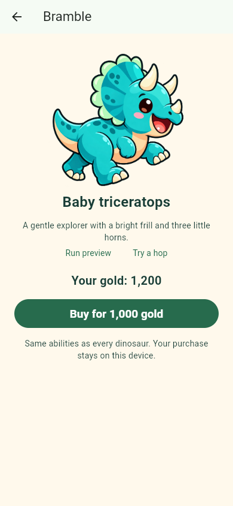
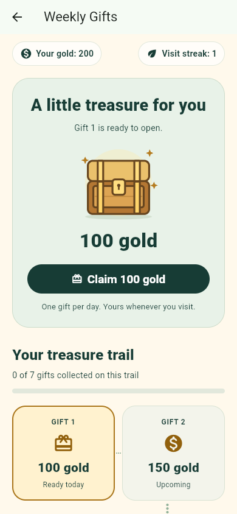
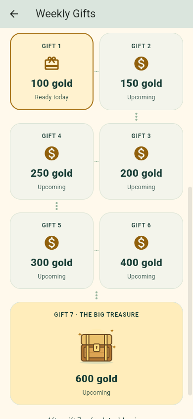
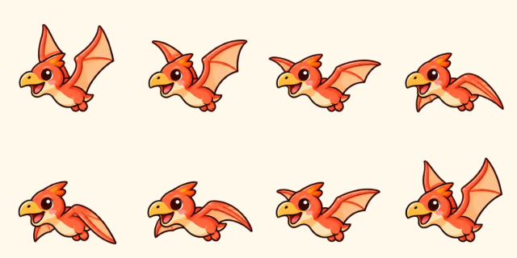

<div align="center">
  
  <h1>Little Dino</h1>
  <p><strong>Little jumps. Big adventures.</strong></p>
  <p>A cheerful, offline dinosaur runner designed for children ages 6–8.<br>Collect gold, meet new dinosaurs, and discover a little treasure each day.</p>
  <p>
    <a href="https://github.com/BlackAlpha-debug/flutter-dinosaur/actions/workflows/verify.yml"></a>
    <a href="LICENSE"></a>
    
    
  </p>
  <p><a href="#download-android-apk">Download APK</a> · <a href="#screenshots">Screenshots</a> · <a href="#getting-started">Get started</a> · <a href="#testing">Testing</a> · <a href="#google-play-release">Release guide</a> · <a href="docs/PRIVACY_POLICY.md">Privacy policy</a></p>
</div>

## About the project

Little Dino combines simple tap-to-jump gameplay with friendly cartoon characters,
three difficulty levels, and a collection built entirely with earned game gold.
It runs without an account or internet connection. The current build has **no ads,
real-money purchases, analytics, social features, or location tracking**.

Maintained by **[BlackAlpha-debug](https://github.com/BlackAlpha-debug)**.
Current app version: **1.5.0+13**. Android is the release target; the web build is
also used for development and visual checks.

**Release status:** in development and being prepared for Google Play. The latest
test APK is available from [GitHub Releases](https://github.com/BlackAlpha-debug/flutter-dinosaur/releases/tag/v1.4.4-preview.1).
A signed store release still needs publisher configuration and physical-device testing;
this README does not imply that the app is already published.

## Features

- **A simple character home:** a large dinosaur on a soft pastel backdrop,
  a tap-to-hop interaction, one prominent Play button, and compact shortcuts
  for the shop, collection and gifts.
- **Three classic trails:** grass and mud, textured stone, and ice, with the
  original open sky and scrolling ground. Stone and ice each have a textured
  ledge that continues through the entire underside. Collection sparkles and shadows remain.
- **Matching obstacles:** grassland cacti, warm rock blocks on the stone trail,
  and blue upright slabs on the ice trail, with smaller/larger groups.
- **Simple controls:** tap to jump and tap again in the air for a double jump.
- **Three difficulties:** Easy, Normal, and Hard, each with its own saved best score.
- **Four dinosaur friends:** preview their running and jumping before choosing one.
- **Animated characters:** six running poses, a tucked jump, and a landing crouch;
  stride cadence follows game speed and pauses with the simulation.
- **Cartoon flyer:** a coral pterosaur with an eight-pose looping wingbeat,
  matching the illustrated dinosaurs and respecting reduced motion.
- **Earned gold economy:** collect coins during runs and unlock cosmetic characters.
- **Treasure trail:** seven daily gifts, a chest-opening animation, clear progress,
  and a larger final reward. Missing a day preserves the reward track.
- **Separate destinations:** Dino Shop, character previews, My Dinosaurs, and Weekly Gifts.
- **Thoughtful pause behavior:** backgrounding or resizing pauses the run;
  returning requires a deliberate resume.
- **Accessible settings:** large controls, scrollable pages, sound and extra-effects
  controls, large-text layouts, and support for the device's reduced-animation setting.
- **Local progress:** scores, coins, characters, gifts, and settings stay on the device.

## Screenshots

<table>
  <tr>
    <th>Home</th><th>Gameplay</th><th>Dino Shop</th>
  </tr>
  <tr>
    <td></td>
    <td></td>
    <td></td>
  </tr>
  <tr>
    <th>Character preview</th><th>Weekly treasure</th><th>Treasure trail</th>
  </tr>
  <tr>
    <td></td>
    <td></td>
    <td></td>
  </tr>
</table>

<details>
<summary>Flying character — wingbeat poses</summary>
<p></p>
</details>

Interface captures come from the headless browser smoke test; the ground
previews and wingbeat sheet are rendered by Flutter widget tests. They illustrate the interface;
they are not measurements of Android frame rate or physical-device performance.

## How to play

1. Choose a difficulty in **Settings**, then select **Play**.
2. Tap the play area to jump over obstacles. Tap once more in the air to jump higher.
3. Collect gold, avoid ground obstacles and flying dinosaurs, and build your best score.
4. Pause whenever you need. Your earned gold is banked as the run progresses.
5. Visit **Dino Shop** to preview or buy a character, and **My Dinosaurs** to equip it.

### Gold and characters

Every collected coin awards 10 base gold. Difficulty multiplies that reward:

| Difficulty | Gold multiplier | Gold per pickup |
| --- | --- | --- |
| Easy | ×1 | 10 |
| Normal | ×2 | 20 |
| Hard | ×3 | 30 |

| Dinosaur | Species | Unlock price |
| --- | --- | --- |
| Sprout | Little T. rex | Free |
| Bramble | Baby triceratops | 1,000 gold |
| Sunny | Baby stegosaurus | 10,000 gold |
| Nova | Baby spinosaurus | 25,000 gold |

All characters share the same speed, jump physics, and collision rules. Unlocks
change appearance. Gold has no cash value and cannot be bought with real money.
Additional Sprout color options are available through the existing pickup unlocks.

### Weekly Gifts

Open today's chest to collect the next fixed reward on your seven-stop trail:

| Gift | 1 | 2 | 3 | 4 | 5 | 6 | 7 |
| --- | --- | --- | --- | --- | --- | --- | --- |
| Gold | 100 | 150 | 200 | 250 | 300 | 400 | 600 |

A complete trail gives **2,000 gold**. Claim one gift per local calendar day;
after gift 7, a fresh trail becomes available on a new day. Gifts are fixed and
shown in advance. Missed days do not erase reward progress. The visit streak is
separate from the gift track and does not change reward amounts.

## Download Android APK

**[Download Little Dino 1.4.4 APK](https://github.com/BlackAlpha-debug/flutter-dinosaur/releases/download/v1.4.4-preview.1/little-dino-1.4.4-preview.apk)**

For **Android 7.0 and later**. Open the downloaded APK on your phone and follow
Android's installation prompts. This is a **debug-signed test build**, not the
Google Play production release.

[Release notes](https://github.com/BlackAlpha-debug/flutter-dinosaur/releases/tag/v1.4.4-preview.1)
· [SHA-256 checksum](https://github.com/BlackAlpha-debug/flutter-dinosaur/releases/download/v1.4.4-preview.1/little-dino-1.4.4-preview.apk.sha256)

The release contains the same version **1.4.4 / build 12** tested on the connected
Android phone. Workflow artifacts remain available as an alternative for developers.

## Getting started

### Requirements

| Tool | Repository configuration |
| --- | --- |
| Flutter | Validated with **3.44.7**; minimum declared SDK **3.44.0** |
| Dart | Validated with **3.12.2**; declared range **≥3.12.0, <4.0.0** |
| Java | JDK 17 or a compatible JDK for the pinned Android build tools |
| Android SDK | Platform 36; minimum supported device API 24 |
| Android NDK | **28.2.13676358** |
| Browser | Chrome for the development web preview |

Dependencies are locked in `pubspec.lock`. Gradle **8.14.1**, Android Gradle Plugin
**8.13.1**, and Kotlin **2.3.0** are configured in the Android project.
Android Studio and an emulator are optional; the project can be built with
command-line tools and tested on a connected Android phone.

### Clone and run

```sh
git clone https://github.com/BlackAlpha-debug/flutter-dinosaur.git
cd flutter-dinosaur
flutter pub get
flutter doctor
flutter run -d chrome
```

For Android, connect a phone with USB debugging enabled, then run:

```sh
flutter devices
flutter run -d YOUR_DEVICE_ID
```

### Build a test APK

```sh
flutter build apk --debug
```

Output: `build/app/outputs/flutter-apk/app-debug.apk`.
This is a testing artifact, not the signed Google Play release.
Successful [GitHub Actions verification runs](https://github.com/BlackAlpha-debug/flutter-dinosaur/actions/workflows/verify.yml)
also retain the `little-dino-debug-apk` artifact for 14 days.

## Testing

Run the core checks from the repository root:

```sh
dart format --output=none --set-exit-if-changed lib test
flutter analyze --no-pub
flutter test --no-pub
```

On Windows, the verification helper also builds the APK and checks native alignment:

```powershell
powershell -File tools/verify.ps1
# Dart/widget checks without the Android build:
powershell -File tools/verify.ps1 -SkipAndroidBuild
```

Tests cover fixed-step simulation, double jumps, pause/lifecycle handling, animation
states, local persistence, purchase boundaries, duplicate claims, seven-day rollover,
reduced motion, and phone/tablet layouts with enlarged text.
See [the validation record](docs/VALIDATION.md) for results and remaining manual checks.

### Browser checks

The optional smoke test requires Python, Node.js, and installed Chrome. It uses
Playwright headlessly and does not launch Android Studio or an emulator.

```sh
npm install --prefix build/browser-qa playwright
flutter build web --no-web-resources-cdn
python -m http.server 7357 --bind 127.0.0.1 --directory build/web
```

With the server running, use another terminal:

```sh
node tools/browser_smoke.cjs
```

The script checks gameplay, animations, purchase/equip flows, gifts, privacy,
persistence, and unexpected network requests. It saves captures and
`screenshots/browser-results.json`. Its clearly marked local-storage wallet
fixture exercises purchases; the production app has no debug coin-grant control.

## Project structure

```text
lib/
  main.dart                 App theme, navigation, game screens, lifecycle
  adventure_home.dart       Simple character home and compact navigation
  game_engine.dart          Fixed-step simulation and difficulty rules
  game_scene.dart           Scaled playfield and scenery
  world_scenery.dart         Original sky, sun/moon, and clouds
  ground_surface.dart        Scrolling grass, deep stone, and ice terrain
  dino.dart                 Jump, landing, and character state
  dino_animation.dart       Distance-based animation frame selection
  dino_avatar.dart          Cached atlas rendering and color variants
  sprite_atlas.dart         Shared decoded atlas renderer
  ptera.dart                Cartoon flying obstacle and eight-pose wingbeat
  dino_catalog.dart          Character metadata and prices
  dino_shop_page.dart        Shop, collection, purchase, and live previews
  weekly_gifts_page.dart     Daily chest and seven-stop reward trail
  treasure_chest.dart        Original scalable chest artwork and animation
  player_progress.dart      Versioned local saves, wallet, gifts, settings
  frame_clock.dart          Bounded rendering cadence
  game_audio.dart           Bundled sound playback and lifecycle
  app_info.dart             Publisher/contact and privacy summary
  ad_service.dart           Disabled boundary for a possible future provider
assets/                     Runtime art, animation atlases, audio, fonts
android/                    Android platform, identity, and signing setup
test/                       Simulation, persistence, layout, and UI tests
tools/                      Verification, release, and browser helpers
docs/                       Policies, plans, provenance, and validation
screenshots/                Reviewed interface captures and browser results
```

The game uses a **400×720 logical playfield** and a **120 Hz fixed simulation step**.
Rendering is capped at 60 Hz; HUD updates are throttled during a run. These are
design limits, not a claim of guaranteed frame rate on every device. Progress
uses local shared preferences with serialized writes and recoverable save errors.

## Privacy and family experience

- No sign-in, advertising SDK, analytics SDK, or remote gameplay service.
- No camera, microphone, contacts, location, or advertising-ID use by the game.
- Audio, fonts, and runtime images are bundled for offline use.
- Progress stays on the device; Android cloud backup for the app is disabled.
- **For grown-ups** includes the full policy, licenses, and a confirmed progress reset.
- Clearing app data or uninstalling can remove progress; there is no cloud restore.

Read the [complete privacy policy](docs/PRIVACY_POLICY.md). Support correspondence
is handled separately when a parent or guardian chooses to email the publisher.

Ads are **off**. `ad_service.dart` is a disabled extension point, not an installed
ad integration. Any future ads release requires a separate implementation and
updated privacy/store declarations; see [ADVERTISING.md](docs/ADVERTISING.md).

## Android compatibility

The current build supports **Android 7.0 / API 24 and later** and targets API 36.
The universal test APK includes ARM32, ARM64, and x86-64 libraries. Menus adapt
to supported phone/tablet windows; resizing an active game pauses it.
TV, Wear OS, automotive interfaces, and devices below API 24 are outside the scope.

Native ELF/ZIP alignment checks cover 16 KB packaging requirements. Physical
device behavior, low-end frame pacing, and the final signed bundle still need
release testing. See [Android compatibility](docs/ANDROID_COMPATIBILITY.md).

## Google Play release

Follow [the release runbook](docs/RELEASE.md) before producing a store bundle:

1. Choose the permanent Android application ID.
2. Publish [the privacy policy](docs/PRIVACY_POLICY.md) at a public HTTPS URL.
3. Complete private `android/release.properties` and `android/key.properties`
   using the committed example files.
4. Configure and back up the private upload keystore.
5. Complete physical-device testing and the Play Console declarations/checklists.
6. Build the signed AAB with the release helper:

```powershell
powershell -File tools/build_release.ps1
```

The helper validates release identity, contact, policy URL, and signing inputs.
Output: `build/app/outputs/bundle/release/`.
Production configuration and keystores are ignored by Git. Never commit signing
passwords, private keys, or real signing property files.

## Documentation

| Document | Purpose |
| --- | --- |
| [Implementation plan](docs/IMPLEMENTATION_PLAN.md) | Original audit and release preparation phases |
| [Coins, characters, and gifts](docs/COINS_CHARACTERS_PLAN.md) | Economy rules and feature implementation phases |
| [Animation](docs/ANIMATION.md) | Sprite provenance, frame timing, and verification |
| [Home and playfield redesign](docs/HOME_EXPERIENCE.md) | Captured UX review, design choices, artwork and evidence limits |
| [Simple home revision](docs/HOME_SIMPLE_REDESIGN.md) | Current character-focused home selected by the owner |
| [Validation](docs/VALIDATION.md) | Completed checks and remaining manual testing |
| [Release runbook](docs/RELEASE.md) | Signing, identity, and Google Play preparation |
| [Android compatibility](docs/ANDROID_COMPATIBILITY.md) | Platform support and performance choices |
| [Privacy policy](docs/PRIVACY_POLICY.md) | Public policy text |
| [Publish the policy](docs/PUBLISH_PRIVACY_POLICY.md) | Public Notion policy setup |
| [Advertising](docs/ADVERTISING.md) | Requirements for a future ads integration |
| [Asset provenance](docs/ASSETS.md) | Sources, bundled licenses, and rights review |
| [Character artwork](docs/DINO_ART.md) | Character descriptions and generation prompts |

## Contributing and support

For a reproducible bug, [open an issue](https://github.com/BlackAlpha-debug/flutter-dinosaur/issues)
with the app version, Android version, device model, and steps to reproduce.
Describe the expected and actual behavior. For UI changes, include screenshots
and check a small phone layout with large text. Run formatting, analysis, and
relevant tests before submitting a pull request.

For parent/guardian support or privacy requests:
**[muzammiljawad6@gmail.com](mailto:muzammiljawad6@gmail.com)**.
Please do not include a child's personal information in public issues or support messages.

## License and acknowledgments

Original project code is distributed under the **[MIT License](LICENSE)**,
Copyright © 2022 **Hevesh Lakhwani**. This repository preserves that notice.
Current development and publishing preparation are maintained by BlackAlpha-debug.

Artwork and font provenance are documented separately in [ASSETS.md](docs/ASSETS.md)
and [DINO_ART.md](docs/DINO_ART.md). The code license does not establish the rights
to every inherited artwork file; the publisher must verify those rights before
commercial distribution. Bundled package/font notices are also available in the
app's grown-ups area.
